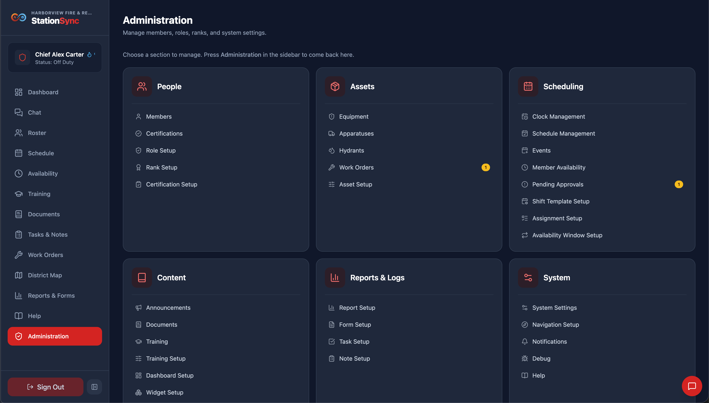
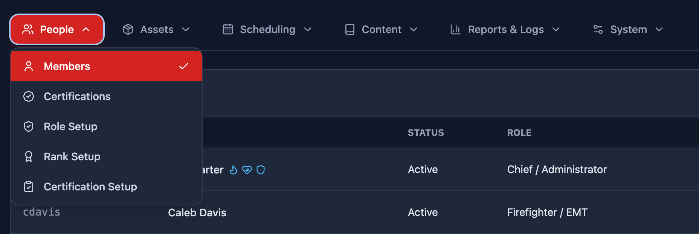
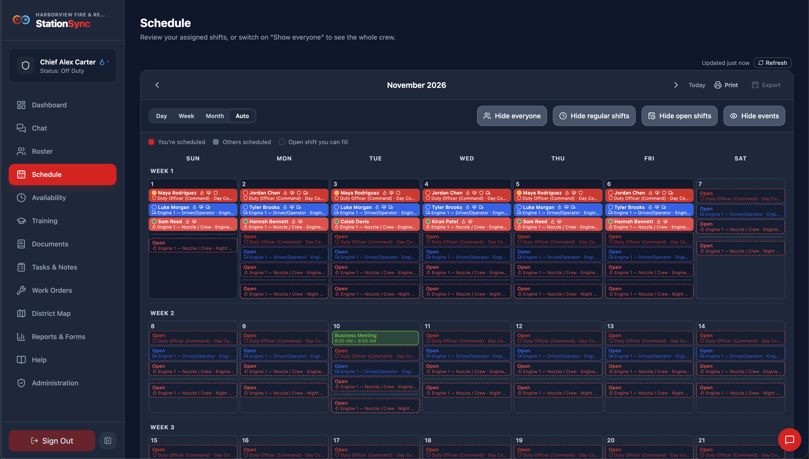
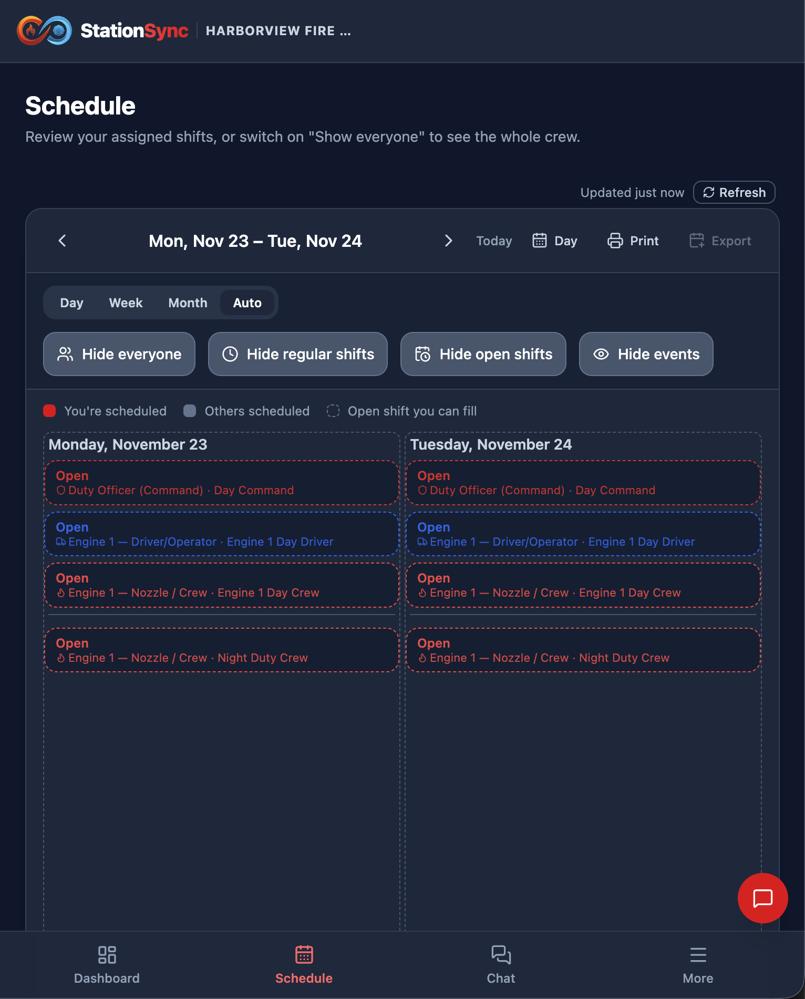
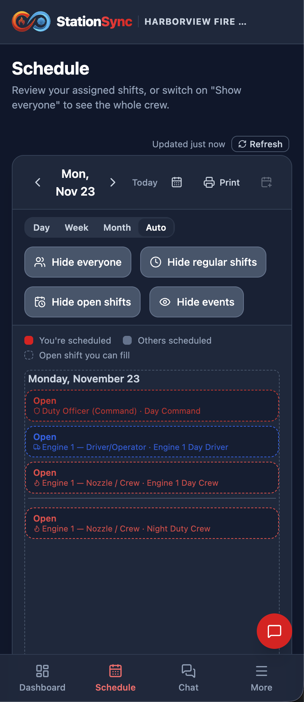

## Welcome

You undoubtedly have made a great decision in choosing StationSync to manage your station's workforce. This guide will help you get started as an administrator for your station - and get things done quickly so you can get back to what matters most.

## About this module

The **Administration** module is where the department is configured. This guide explains how the module is organized and, more importantly, **why you can see the tabs you can see**. Each tab then has its own guide in the list on the left.

## What loads, and when

Nothing is read until you need it. The app reads what the screen in front of you draws — and nothing else — so opening a tab may show a brief **Loading …** line the first time.

That line is worth knowing about, because it tells apart two things that look alike: a list that is **still arriving** shows the loading line, and a list that is **genuinely empty** shows none. If you see an empty table with no loading line, nobody has put anything there yet.

## The tabs

| Group | Tabs |
|---|---|
| **People** | Members, Certifications, Role Setup, Rank Setup, Certification Setup |
| **Assets** | Equipment, Apparatuses, Hydrants, Work Orders, Asset Setup |
| **Scheduling** | Clock Management, Schedule Management, Events, Member Availability, Pending Approvals, Shift Template Setup, Assignment Setup, Availability Window Setup |
| **Content** | Announcements, Documents, Training, Training Setup, Dashboard Setup, Widget Setup, Chat Setup, Map Setup |
| **Reports & Logs** | Report Setup, Form Setup, Task Setup, Note Setup |
| **System** | System Settings, Navigation Setup, Notifications, Debug, Help |

## Two people saving at once

If Administration is edited by more than one person, a save can meet another save. Nothing is lost silently:

Administration saves are **last-writer-wins**: if two people save the same record, the second save is the one that stands, so open a record fresh before editing it rather than leaving one open in a tab. The writes that could corrupt each other — clocking in and out, approving a shift offer, saving a personal-best score — run as all-or-nothing transactions on the server, and a save that fails for any reason means **nothing was applied**, so pressing Save again is safe.

## About Security & Privacy

StationSync is built specifically for emergency services agencies, where data security, member privacy, and operational integrity are paramount.

- **Department Data Ownership** — Your fire department is the sole owner (Data Controller) of all personnel rosters, timeclock punches, schedules, training records, and maintenance logs. StationSync acts strictly as a data processor on your behalf. We do not sell, rent, or monetize department data, and we never use your information for advertising or behavioral tracking.
- **Tenant Isolation & Access Control** — Every department's records are logically segregated in a cloud-based database backed by Google's world-class Firebase products. Granular Role-Based Access Control (RBAC) is enforced at both the client layer and the database security rule layer, ensuring that regular members cannot view sensitive administrative settings, personnel details, or audit logs.
- **Authentication & Credential Protection** — User authentication is powered by enterprise-grade cryptographic standards. Passwords are never stored in plain text and are protected using industry-standard salted hashing algorithms. Administrators can mandate password changes upon initial sign-in, and password updates immediately revoke existing sessions on other devices.
- **Momentary Geofencing (No Continuous Tracking)** — If your department enables station geofencing for clocking in or out, coordinates are verified only for a single instant when the punch button is pressed. StationSync does not track, monitor, or store continuous background location.
- **Encryption In Transit & At Rest** — All network communications between member devices and station servers use modern TLS/HTTPS encryption. Data stored in cloud databases and file storage buckets is automatically protected with AES-256 encryption at rest.
- **Continuous Backups & Disaster Recovery** — The system maintains continuous Point-in-Time Recovery (PITR) change logging, allowing database state to be rewound to any minute in the preceding 7 days. Additionally, automated daily cold storage snapshots are exported every night at 2:00 AM and retained in Google Cloud for 365 days.

## This app's technical stack

StationSync combines modern web technologies with enterprise cloud infrastructure to provide a fast, reliable, and offline-capable platform that works on station computers, truck tablets, and personal phones alike.

- **Frontend Application** — A high-performance Single Page Application (SPA) built with **React**, **Vite**, and **Tailwind CSS**. It delivers instant page switches, dark mode support, and an adaptive layout optimized for touchscreens and desktop monitors (see below).
- **Cloud Infrastructure & Backend** — Built on **Google Cloud Platform (GCP)** and **Firebase**, utilizing serverless **Cloud Functions (Node.js)** for transactional operations, scheduled background workflows, and automated system maintenance.
- **Database & Real-Time Sync** — **Cloud Firestore** provides distributed, globally available NoSQL document storage with sub-second synchronization across connected crew devices, atomic write transactions, and local memory caching.
- **Asset & File Storage** — **Cloud Storage for Firebase** securely hosts user avatars, certification card scans, document library files, pre-incident plans, and repair photos with declarative storage security rules.
- **Push Notification Engine** — Multi-platform push notifications routed through **Firebase Cloud Messaging (FCM)** and the **Web Push API** (via APNs for Apple devices), delivering immediate shift offers, approval alerts, and broadcast announcements.
- **Offline District Mapping** — Powered by **Leaflet** with vector geometry rendering. County GIS beats, road networks, waterways, FEMA flood layers, and hydrant locations are cached locally, allowing the district map to open and navigate with zero cellular connectivity.
- **Client-Side PDF Generation** — Built-in form automation powered by **PDF-lib**, generating filled state training forms and department reports directly in the user's browser without routing sensitive member records through third-party PDF services.
- **Web Audio Engine** — Custom station audio chimes and messaging sounds synthesized via the browser's native **Web Audio API** with individual sound volume controls.

## One App, All the Devices

StationSync supports nearly all devices, including desktop, tablet, and mobile devices. Our software is designed to be user-friendly and intuitive, allowing you to access your data and perform tasks with ease.

**Desktop:**

**Tablet:**

**Phone:**

## Thank you

We appreciate your interest in our fire station workforce management software. Our mission is to provide you with a comprehensive and efficient solution to manage your fire station's operations. Our software is designed to streamline your workflow, improve communication, and increase overall efficiency.

StationSync was created by a firefighter, so we understand that managing a fire station can be challenging - our software is here to help! Our team is committed to providing you with the best possible support and assistance. We look forward to working with you and helping you achieve your goals.

Thank you for considering StationSync!
