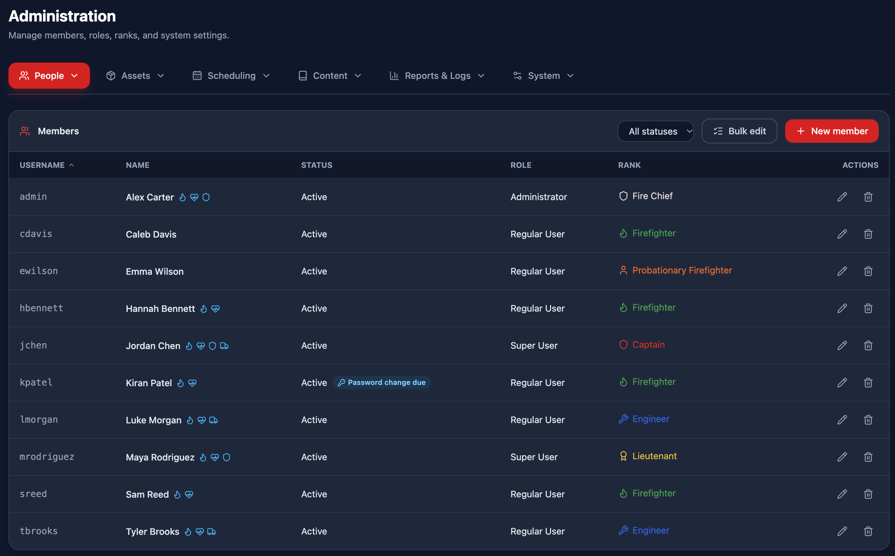
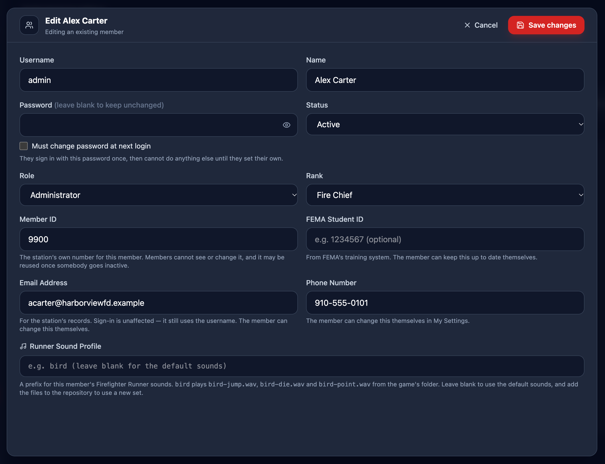

*People → Members* is where department user accounts and personnel profiles are managed.

> [!IMPORTANT]
> Configuring users requires the **Manage users** role permission.

## The fields

| Field | Notes |
|----|----|
| **Certification Icons** | A quick glance at critical certifications this member may have - see **Certifications** |
| **Actions** | Clickable buttons for you to either **edit** or **delete** |

> [!NOTE]
> **Name matters more than you might expect.** It is what members see on the *Currently on duty* card, what appears on schedule pills and in the crew list, and what is sent in a push notification. We recommend using just their first and last name, do not prefix their name with their rank.

## Creating and editing

1. Press **New member** at the top right of the roster.
2. The editor opens over the page, with Save and Cancel in a bar at the top of it.
3. Fill in the form and save.
4. **Allow a few seconds** — an admin save reloads the *whole* directory, the schedule, the templates and the offers, so other tabs reflect the changes immediately.

## Personal details

| Field | Notes |
|---|---|---|
| **Username** | What they sign in with, it must be unique. The username is only ever used for logging in. |
| **Name** | The display name used everywhere — schedules, clock entries, availability, notifications |
| **Password** | The string of alphanumeric characters that are used to log in. You may require a certain password strength in **System Settings**. |
| **Must change password at next login** | (See below) |
| **Status** | **Active** or **Inactive** - inactive members are not shown in the crew list, and cannot be assigned to shifts. |
| **Role** | Decides what the user can do in the system — see **Roles** |
| **Rank** | Decides which shifts they may be given and offered, as well how to style their name and icon across the app — see **Ranks** |
| **Member ID** | The station's own number for the member, we recommend using an assigned radio callsign, if the member has one. This number may be reused once somebody goes inactive. |
| **FEMA Student ID** | The *Student Identification* number from FEMA's training system. At least in North Carolina where this software originates, this number has become increasingly more important. |
| **Email Address** | For the station's records, this has no impact on the app's functionality. |
| **Phone Number** | For the station's records, this has no impact on the app's functionality. |
| **Runner Sound Profile | For the mini game "Firefighter Runner", which has it's own guide. For amusement purposes, you can set special sound sets to a user's profile. Contact StationSync if you are interested in this. |

> [!NOTE]
> **Leaving the password blank on an edit keeps the existing one.** Passwords are stored as a salted hash, so the form cannot show you the current one; blank is how you say "do not change it". Typing a new password replaces it and **signs that member out of their other sessions** — worth warning them about.

## Handing over a password the member has to replace

You should always check **Must change password at next login** when you set someone's password for them — a new member, or anyone who has forgotten theirs. They sign in with that password once are brought straight to a *Choose a new password* popup. They cannot open any other part of the app until they save a new one, or, they can sign out instead.

> [!NOTE]
> **The check and the password belong together.** Unchecking the box does not change anybody's password; it only says whether or not the current one may be kept.

## Deactivating rather than deleting

Setting **Status** to *Inactive* is usually better than deleting. An inactive member cannot sign in, but their clock history, past shifts and availability stay intact, and reactivating them later restores everything. Deleting removes the row, and their records are left pointing at a member who no longer exists, **which can cause errors**.

> [!CAUTION]
> Only delete users that have no information related to them, or are duplicated.
