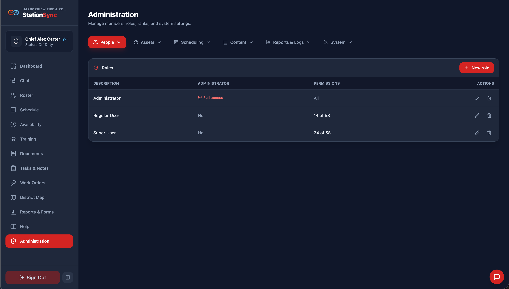
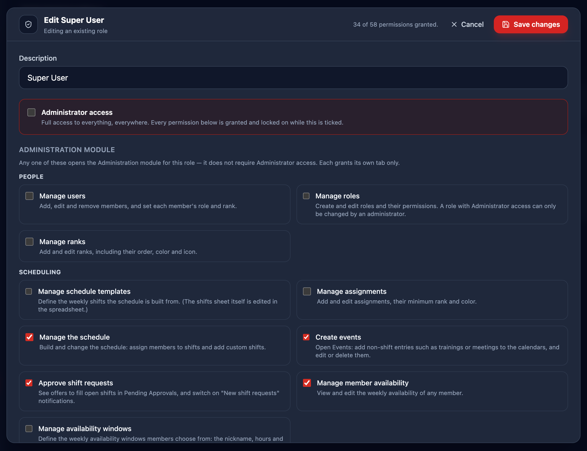

*People → Role Setup* is where user permissions and access rights are configured for the app. A member can only have **one** role, and the role decides which modules appear in their sidebar, which Administration tabs they can open, what reports they can see... almost everything about the app's functionality depends on the role.

> [!IMPORTANT]
> Configuring roles requires the **Manage roles** permission in your own role.

## How to use

The role list is at the top of the tab. Press **New role** in its header, or click a role in the list to edit it.

Once the editor is open, make changes as you see fit, and Save.

> [!WARNING]
> We **strongly** recommend against using common fire service rank titles (i.e. Chief, Captain, etc.) as role names to avoid confusion. If you decide to do that anyway, we would recommend you have a role for every rank that you have, so they match.

## Administrator access

**Administrator access** is the master switch. While it is checked:
- the role can use every module and every tab, and
- the other permission boxes are **checked and locked**, because a master switch that could be contradicted by another box would not mean anything.

Uncheck it and the boxes become editable again, so you can build up a role from nothing.

## The permissions

Permissions are grouped under clear section headers matching the application areas: **People**, **Scheduling**, **Records**, **Communication**, **Reports & forms**, and **Station setup** on the administration side; and on the member side, **Their own schedule and hours**, **The crew and its records**, **The district**, and **Chat**.

Each permission grants its own tab, or its own member-facing ability. None of them grant Administration as a whole.

**People**

- **Manage users** — *People → Members*.
- **Manage roles** — *People → Role Setup*. Cannot be used to grant Administrator access, or to edit or delete a role that has it; only an administrator can do that.
- **Manage ranks** — *People → Rank Setup*.

**Scheduling**

- **Manage schedule templates** — *Scheduling → Shift Template Setup*.
- **Manage assignments** — *Scheduling → Assignment Setup*.
- **Manage the schedule** — *Scheduling → Schedule Management*.
- **Can create events** — *Scheduling → Events*.
- **Approve shift requests** — *Scheduling → Pending Approvals*.
- **Manage member availability** — *Scheduling → Member Availability*.
- **Manage availability windows** — *Scheduling → Availability Window Setup*.

**Records**

- **Manage the timeclock** — *Scheduling → Clock Management*.
- **Administer trainings** — *Content → Training*.
- **Set up trainings** — *Content → Training Setup*.
- **Manage certifications** — *People → Certifications*.
- **Set up certifications** — *People → Certification Setup*.
- **Manage documents** — *Content → Documents*.
- **Manage equipment** — *Assets → Equipment*.
- **Manage apparatuses** — *Assets → Apparatuses*.
- **Manage hydrants** — *Assets → Hydrants*.
- **Set up equipment & apparatus** — *Assets → Asset Setup*.
- **Manage work orders** — *Assets → Work Orders*.
- **Set up tasks** — *Reports & Logs → Task Setup*.
- **Set up notes** — *Reports & Logs → Note Setup*.

**Communication**

- **Make announcements** — *Content → Announcements*.
- **Manage chat rooms** — *Content → Chat Setup*.
- **Manage dashboard setup** — *Content → Dashboard Setup*.
- **Manage widget setup** — *Content → Widget Setup*.

**Reports & forms**

- **Configure reports** — *Reports & Logs → Report Setup*.
- **Configure forms** — *Reports & Logs → Form Setup*.

**Station setup**

- **Manage system settings** — *System → System Settings*, *Content → Map Setup*, and *System → Navigation Setup*.
- **Maintain the district map** — *Content → Map Setup* by itself, without full settings access. Requires *View the district map*.
- **Manage notification settings** — *System → Notifications*.
- **Access the debug page** — *System → Debug*.

**Member abilities**

These do not open Administration at all; they decide what the member can do in their own modules.

- **Access dashboard** — the **Dashboard** module and its widgets.
- **View my schedule** — the **Schedule** module.
- **Make offers** — offering to fill open shifts. Cannot be stored without *View my schedule*.
- **View full schedule** — the **Show everyone** button on Schedule. Cannot be stored without *View my schedule*.
- **Edit own availability** — the **Availability** module.
- **Use the timeclock** — the **Clock In**/**Clock Out** buttons and the **Clock History** module.
- **View roster** — the crew **Roster** directory.
- **View reports** — running department reports.
- **Sign trainings** — the **Training** module for reviewing and signing attendance.
- **Manage trainings** — the add/edit form in the Training module. Requires *Sign trainings*.
- **View documents** — the **Documents** module for guidelines and procedures.
- **Verify signatures** — confirming other members' signed checklist items and acknowledged documents. Requires *View documents*.
- **Add assessment scores** — grading practical evaluations and drills.
- **Generate forms** — generating filled PDF forms.
- **View work orders** — viewing and submitting maintenance requests.
- **Tasks & notes permissions** — viewing, completing, editing, and managing daily chore checklists and shift logs.
- **The district** — viewing and editing landmarks on the **District Map**.
- **Chat** — accessing chat, sending messages, editing, or deleting messages.

## Dependencies

Five permissions require another, and the form disables them with the reason in the tooltip:

- **Make offers** requires **View my schedule** — there is no schedule to offer on otherwise.
- **View full schedule** requires **View my schedule** — there is no calendar to show everyone on otherwise.
- **Manage trainings** requires **Sign trainings** — the add/edit form lives inside the Training module, which a role without *Sign trainings* cannot open.
- **Manage documents** requires **View documents** — managing documents you cannot see is not a thing.
- **Verify signatures** requires **View documents** — a verifier has to be able to see the checklist they are confirming, and the tab the panel lives on.

> [!NOTE]
> Availability is deliberately **not** chained this way: a role may manage other members' availability without the member-facing *Edit own availability*, since one is a scheduling job and the other is a personal one.

> [!NOTE]
> **The Documents tab is the one tab two permissions open.** *Manage documents* is the obvious one; *Verify signatures* opens it too, because that is where a verifier confirms another member's checklist items — or a document whose author asked for its signature to be confirmed — without needing to be able to edit it. A role with only the verifying permission sees just that panel — no editor, no folders, no signature report. Both permissions require *View documents*, so neither can be stored on a role that cannot see documents at all.

## Which flags to check for a shift approver

Someone who approves shifts needs **Approve shift requests**, and if you want them to receive the push notification about new offers they also need that same check — the notification and the tab use one permission, not two. They do **not** need **Manage the schedule** unless they also build the schedule.