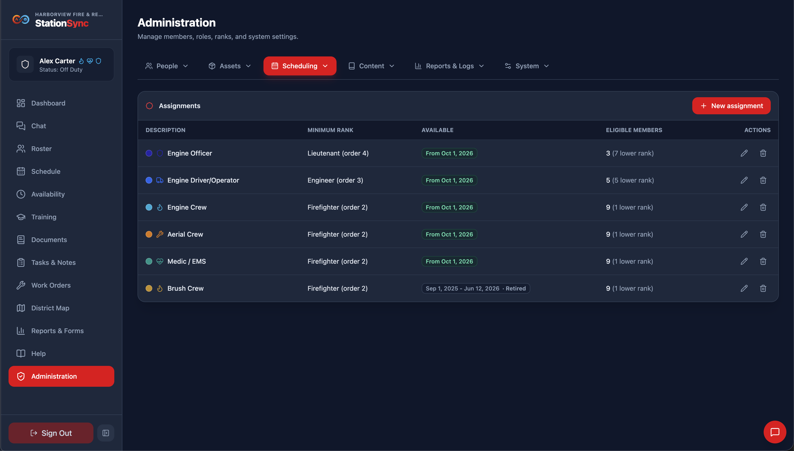
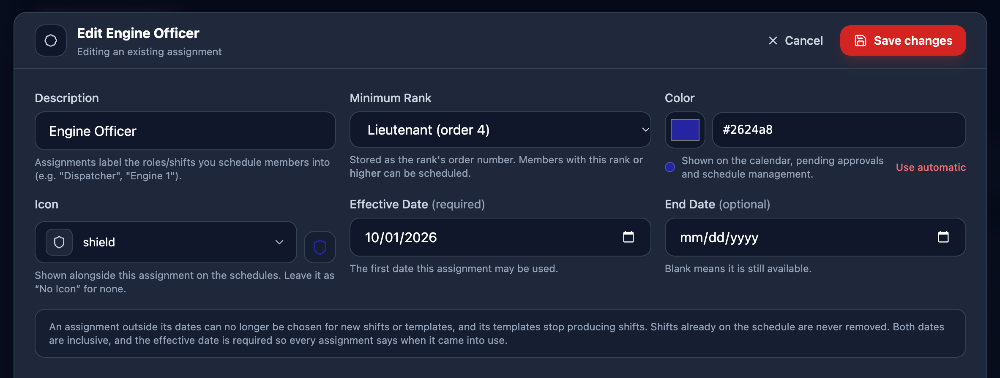
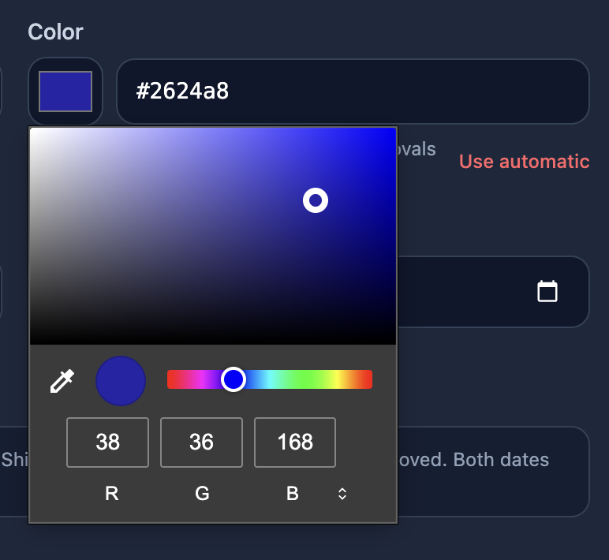
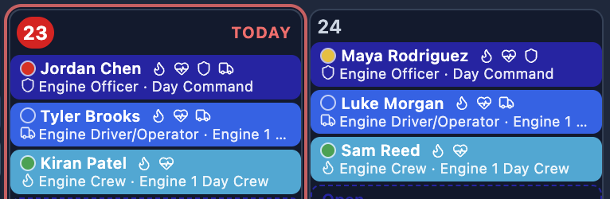

*Scheduling → Assignment Setup* defines **what a shift is** — Driver, Officer, Firefighter, etc. Both the schedule templates and the one-off custom shifts are built from these, so this is the first thing to set up.

> [!IMPORTANT]
> Configuring assignments requires the **Manage assignments** role permission.

## Adding an assignment

Press **New assignment** at the right of the list to open the editor, then complete the following fields as appropriate:

1. **Description** — something members will recognize. This is drawn on every pill for the shift, so keep it short. See more on naming below.
2. **Minimum Rank** — the lowest rank that may take it.
3. **Color** and **Icon** — as below.
4. **Effective Date** — required; the first date the assignment may be used. **End Date** — leave blank unless you are retiring it; see below.
5. Save, then check **Schedule Management**: existing shifts using this assignment update immediately, because a shift stores a reference to the assignment rather than a copy of it.

### Naming
As indicated above, keep the description short. It is drawn every shift slot on the schedule.

**Larger departments** or those that schedule members to specific apparatuses or stations, might consider naming their assignments according to apparatus or station. For example, *S1 - Crew* for a crew member at Station 1. Or, *E1 - Crew* for a crew member on Engine 1.

**Smaller departments** or those that schedule members more generally, have a little more freedom in naming, since something like *Officer* or *Crew* is sufficient.

### Minimum rank

This is the field with real consequences. The assignment stores the **rank order number** of the minimum rank, and a member may fill the shift if their own rank order is at least that high.

For example:

- Set a *Firefighter* minimum and everyone from Firefighter upwards can take it, including a Captain covering a vacancy.
- Set a *Lieutenant* minimum and firefighters cannot be scheduled onto it or offered it.

The comparison uses rank **order**, not rank names, so reordering your ranks changes assignment eligibility. See **Ranks** before editing the order.

### Colors

The color is used for every pill this assignment appears on. It is how people tell shifts apart at a glance, so it is worth setting deliberately. As with naming, you might consider setting related assignments similar in color, for example - a ladder truck's assignments all being the color orange while an engine's assignments all being from a different color hue.

If you have a smaller department where members aren't scheduled and assigned to specific trucks, setting every assignment to a completely different color is a good idea.

Leave the color blank and the assignment keeps an **automatic color** derived from its id. That is perfectly usable — the app will never leave a shift uncolored — and it means you only need to choose colors for the assignments you want to distinguish strongly.

### Icons

The icon catalog is the same one the **Ranks** tab uses, so the two look like one system. The icon is drawn beside the assignment name on schedule pills, in the schedule details list, and in the pending-approvals queue.

## Deleting an assignment

Shifts and templates that referenced it keep their record but lose the name, color and rank rule. Vacancies on those shifts fall back to a generic label instead of the assignment name.

> [!CAUTION]
> Avoid deleting assignments. If you are replacing one, **retire it with an End Date** and add the replacement with an Effective Date. The shift history then stays readable, and you only delete an assignment you have just created by mistake.

### Retiring an assignment instead of deleting it

The **Effective Date** is required: every assignment says when it came into use. The **End Date** lets you retire one without deleting it. That matters because deleting an assignment strips the name, color and rank rule from every shift that used it — so a shift from last year stops reading the way it read when it was worked.

A retired assignment:

- **Cannot be chosen for anything new.** It disappears from the assignment pickers on the schedule board and on the schedule templates form.
- **Stops producing shifts through its own templates**, the same way a retired template does.
- **Does not remove shifts already on the schedule.** Those are real shifts that were worked or are planned; they keep their name, color and icon, and anyone assigned to one stays assigned.

> [!IMPORTANT]
> Retiring an assignment also stops every template that uses it from drawing shifts. The form warns you and names how many, but if the shift pattern should carry on after the assignment ends, give those templates their own end dates instead.

Both dates are inclusive — an assignment effective July 1 can be used *on* July 1, and one ending June 30 can be used *on* June 30. The end date **must not be before** the effective date.