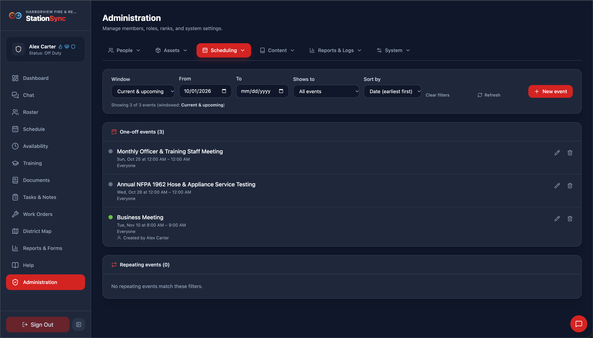
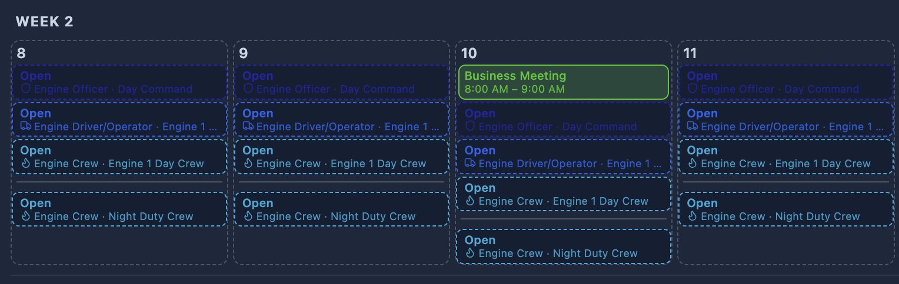
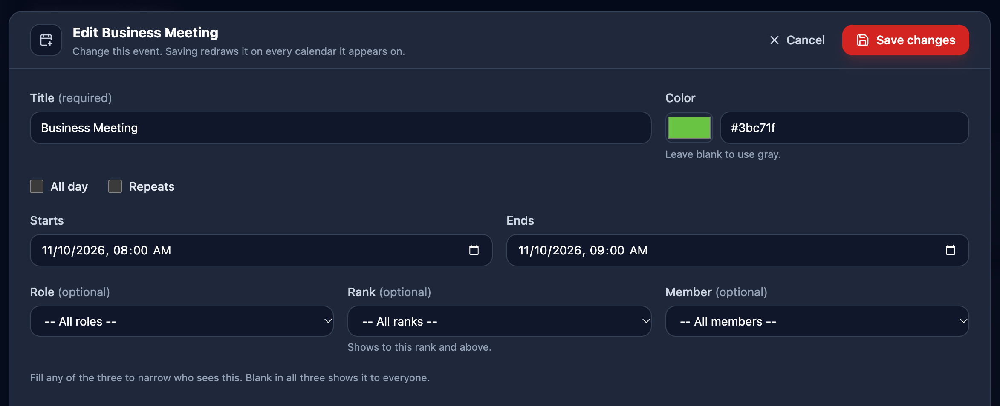
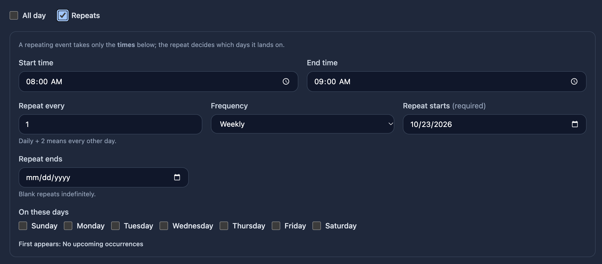
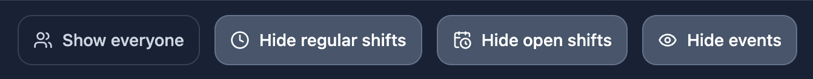

*Scheduling → Events* are the entries on the calendars that are **not** shifts — training, a company meeting, a detail, a fundraiser. They sit alongside the shift pills so the month reads as a whole picture. Events in this app work very similarly to calendar events in other applications like Google Calendar and Microsoft Outlook.

> [!IMPORTANT]
> You must have the **Can create events** role permission in order to create events.

## An event is not a shift

This distinction is worth knowing, because it explains everything else on this page:

- An event **never fills a shift**. It does not occupy a slot, it cannot be offered for, and it does not change who is scheduled.
- An event appears on **every day it covers**. A shift is drawn once, on the day it starts; a three-day event is drawn on all three days.
- An event can **repeat** without one row per occurrence.

| Field | What it does |
|---|---|
| **Title** | Required. What shows on the pill and in the list. |
| **Color** | Any hex color. Blank uses gray. |
| **All day** | The event covers whole days and its times are ignored. Its end date is *inclusive*, so Mar 1 to Mar 3 is three days. |
| **Repeats** | Turns the event into a repeating one — see below. |
| **Role / Rank / Member** | Who sees it. All three blank shows it to everyone. |
| **Starts / Ends** | The window. For a repeating event only the *times* are used. |

Events are then split into **two cards**:

- **One-off events** — the majority, created ad hoc.
- **Repeating events** — fewer of them, and worth looking at together: a repeat that lands on the wrong weekday is the mistake this screen invites.

The order is **chronological**, earliest first. A repeating event is filed under the date its repeat **starts**, not the anchor date in `date_from` — which is only there to carry the times, as the *Repeating events* section explains below.

### Repeating events

A repeating event is described by a **start date**, an **amount** and a **frequency**, rather than by one row per occurrence.

- **Repeat every** is the amount. `1` means every one; `2` means every other.
- **Frequency** is daily, weekly or monthly.
- **Repeat starts** is required — it **anchors** the pattern, and it is not necessarily the first day the event appears (see the note below).
- **Repeat ends** is optional. Leave it blank and the event repeats indefinitely.

Some worked examples:

- Daily, every `2` → **every other day**, starting on the repeat start date.
- Weekly, every `1`, checking Monday and Thursday → **every Monday and every Thursday**.
- Weekly, every `2`, checking Monday and Thursday → **every other week**, on both of those days.
- Monthly, every `1`, day of the month `15` → the **15th of every month**.
- Monthly with day `31` → **months without a 31st are skipped**, rather than moving the event to the 30th. February is skipped most years.

> [!NOTE]
> For a repeating event, **Starts** and **Ends** supply only the times. A repeating event covers one day (or one night) per occurrence; it cannot span several days the way a single all-day event can.

> [!IMPORTANT]
> The repeat start is the **anchor, not the first occurrence**. A Tuesday repeat anchored on a Thursday first appears on the **following Tuesday** — anchor Thu Sep 24, check Tuesday, and it lands on Tue Sep 29. That is why the form shows **First appears:** once you pick a frequency, and why the list shows a **Next:** line. Trust those two lines over the repeat start date.

> [!NOTE]
> A repeating event stores an anchor date alongside the times it runs at. Only the times decide when it lands, so do not read the anchor as the day the event runs.

### Rank targeting means "and above"

A **Rank** target is not a single rank. Choosing *Driver* shows the event to Drivers **and everyone senior to them**. That is deliberate: "the officers need to know" usually means the chief does too.

> [!IMPORTANT]
> A member with **no rank** assigned does not match a rank-targeted event, because there is nothing to compare against. If an event has to reach everybody, leave the Rank blank.

The three targeting fields are combined, so filling Role *and* Rank narrows the audience rather than widening it — it reaches only members who match both.

## Showing and hiding events

Every calendar has a **Show/Hide events** button, on by default. The button only appears when there is at least one event to show.

> [!TIP]
> To retire an event rather than delete it, set its **End date** in the past (or its repeat end, if it repeats). The record stays in the list and re-running it later is a single date change.