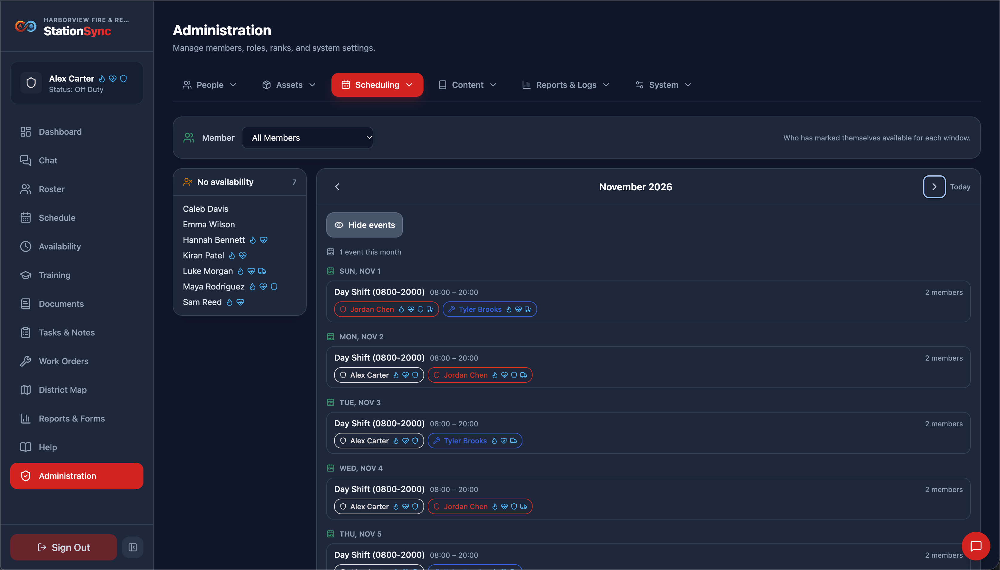
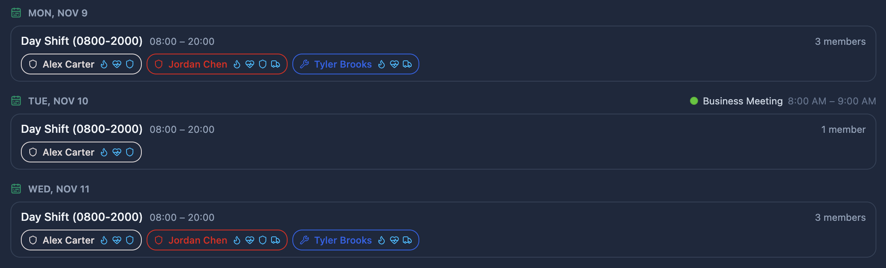
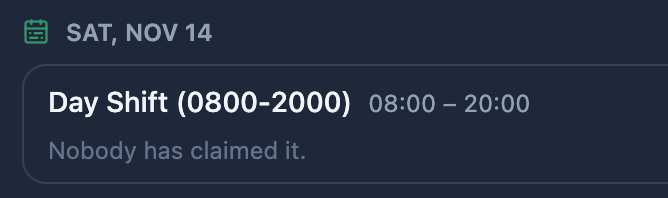
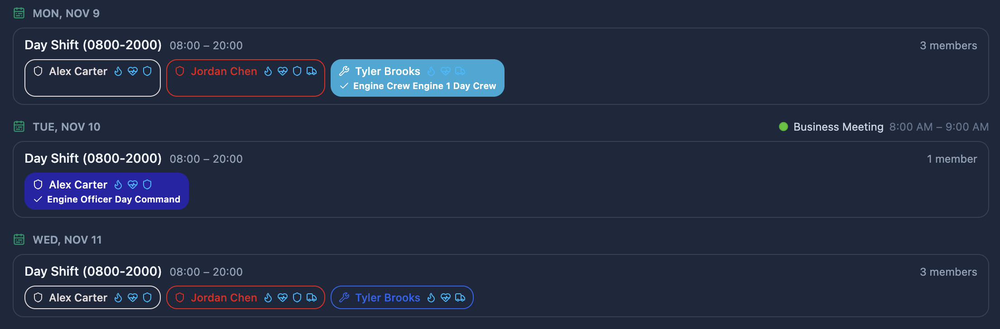
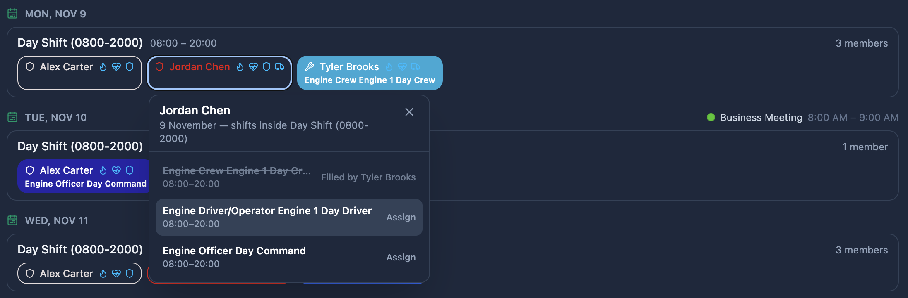
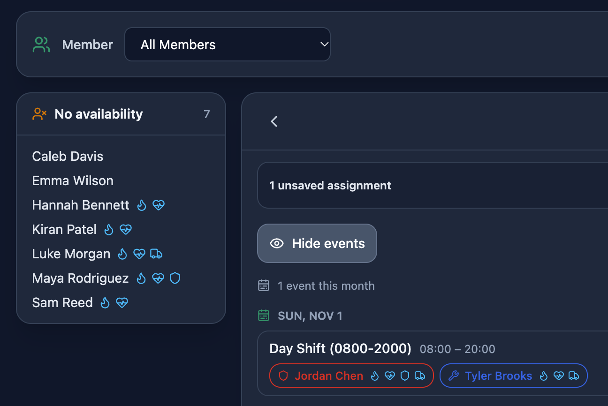
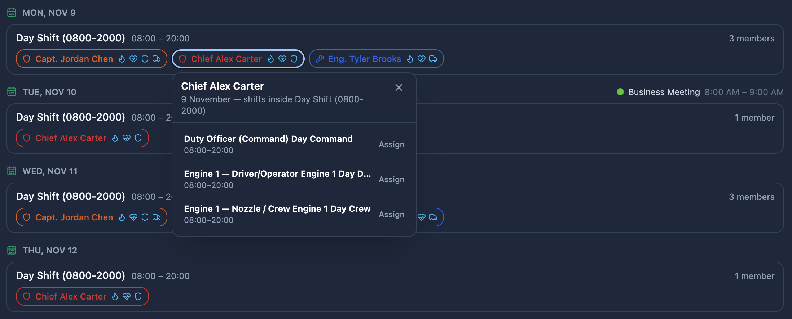
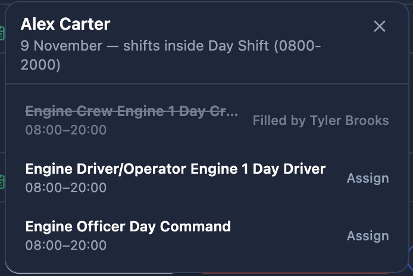
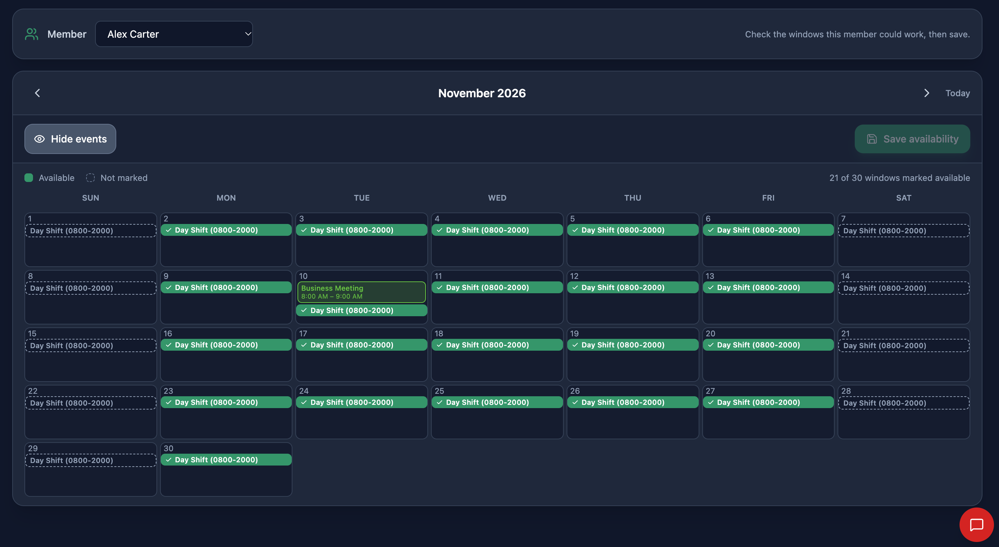

*Scheduling → Member Availability* answers one question: **who is available to work each shift?** Members claim the availability windows they could work in their own My Availability module, and this tab is where that is read and corrected. When used appropriately, this tab can be one of the most valuable tabs in the entire app - it makes creating the schedule amazingly easy.

> [!IMPORTANT]
> Viewing and maintaining member availability requires the **Manage member availability** role permission.

## What availability is and is not

Availability is a **statement of interest**, not a commitment and not a permission:

- It does **not** put anyone on a shift. Only the schedule does that.
- It does **not** block scheduling. You can fill any shift with anyone the rank rules allow, and the schedule board simply warns when someone has not marked that shift available.
- It **does** tell you who to call first when you need cover, which is its main use.

## All Members

The tab opens on **All Members**, because the overview is the point of the screen.

It lists, for each day of the month, the availability windows that fall on it, with:

- the window's nickname and its hours, and
- the names of the members who claimed it — each carrying their rank's color and icon.

Windows come from *Scheduling → Availability Window Setup*, so the list is short and the same for everybody. An empty window is worth spotting: it is a gap to fill or a window nobody wants.

### Getting data from the server

The list reads **that month's shifts as it opens**, because those are what fill the chips in. It reads a month at a time rather than the whole schedule, it is skipped when the app is already holding the month, and it happens once per month — so an officer who has just come from the schedule board doesn't cost extra reads for loading it.

> [!NOTE]
> Availability is **not rank-gated, by design**. A window is an hour of the station's week rather than a slot somebody has to qualify for, so a name on this list means "they could work it", not "they are eligible for the shift that happens to fall then". The rank rules still govern who you may *schedule* — see **Ranks**.

### Creating the schedule from availability

**A name that is already on a shift is filled in with that shift's color** — the same solid color the schedule board uses for a staffed shift — with the shift's name printed under the member's name. That color belongs to the **assignment**, not the rank, so a filled chip is telling you what the shift is; hover it for the full label, and click it to change what they are on.

> [!CAUTION]
> **Don't forget to save your changes!** Use the Save button at the top when finished.

### Those who have no availability

Beside the days sits **No availability**: the members who have marked nothing at all that month, which is the list to work from when you are chasing people before the month closes. 

It counts **only the members whose role can set their own availability** — the role permission *Set their own availability*. Somebody whose role cannot be found, or who has no role at all, is excluded from this list.

### Building the schedule from this list

**A name on this list is a button.** Click one and a menu appears beside it offering the shifts that fall on that day — the ones your schedule templates generate for that weekday, *plus* any one-off shifts that have been added for the date.

**Only the shifts inside the window that name sits under are offered.** A member who claimed an *18:00–06:00* night is not offered the *06:00–18:00* day shift on the same day, because they have not said they can work it. A shift that runs past the end of the window is left out too — they said they were free until 06:00, and a shift ending at 08:00 would have them leave early. If nothing fits, the menu says so and how many shifts it set aside, so an empty list is never a mystery.

- A shift **nobody is on** can be taken: pick it, and that member is assigned to it.
- A shift **somebody already holds** is struck through and says who holds it, and cannot be picked. If it is already theirs it says so — which is how the same person is kept off the same shift twice.
- The menu lists the day's shifts in time order, so you can see what else the window holds. To put somebody on a shift **outside** their claimed hours, use *Scheduling → Schedule Management*, where the whole day is on the board.

Each chip you have given something to shows a checkmark and the shift's name, and the bar at the top counts the checkmarks for what is **pending**. A name the schedule already holds is filled in and names its shift without one.

> [!IMPORTANT]
> **Nothing is saved until you press Save.** Every choice is held as a draft, so a whole month can be built in one pass, and **Discard** throws the lot away. That is deliberate: half a month applied because a tab was closed is a schedule nobody asked for.

> [!NOTE]
> Assigning a shift changes the **schedule**, so it needs *Manage the schedule* in your role. A role with only *Manage member availability* can open this screen and use the menus, but the save will be refused — and the refusal says exactly which permission is missing, so it can be passed to whoever administers your roles.

## One member at a time

Pick a member from the dropdown and you get **the same calendar they see**: a month grid of the windows that fall in it, with their marks.

- Change it exactly as they would, then save. It is one batched request.
- **Discard** throws pending changes away, and switching member does too, so one person's draft never leaks into another's.
- Past dates are shown but cannot be edited.

This is what you use when someone calls in their availability, or when a member asks you to change it because they cannot sign in. 

> [!WARNING] 
> From a workflow standpoint (and officer sanity), it is strongly recommended that members enter their own availability.

## Troubleshooting why a window shows nobody

In order of likelihood:

1. **Nobody has opened their availability this month.** It is a manual action, and a quiet month looks the same as a broken feature. If it is consistently empty, ask people to check their own screens.
2. **The month is not loaded.** If the tab says so, press **Load month** — the app will not show you an unloaded month as if it were empty on purpose, but the notice is easy to skim past.
3. **The window has been retired.** A window whose end date has passed still reads in the history but offers nothing new, so it appears on no day. Check *Scheduling → Availability Window Setup* for an **In force** badge.
4. **The window covers a different day than you expect.** A window is drawn on the days it is checked for, and that is the day it **starts** — a Tuesday night running to 08:00 belongs to Tuesday.
