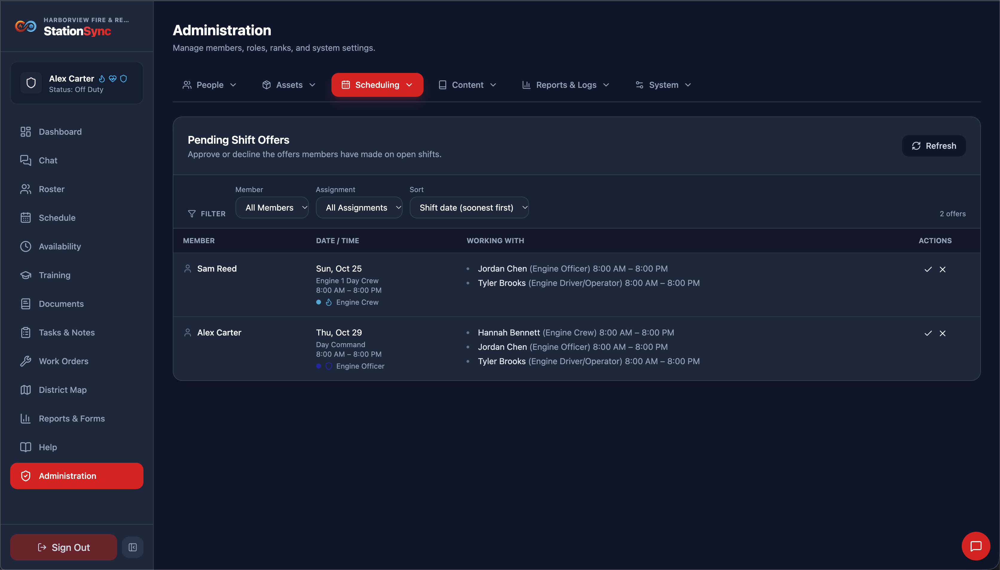
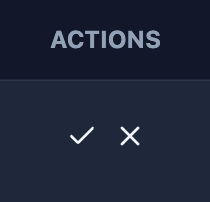
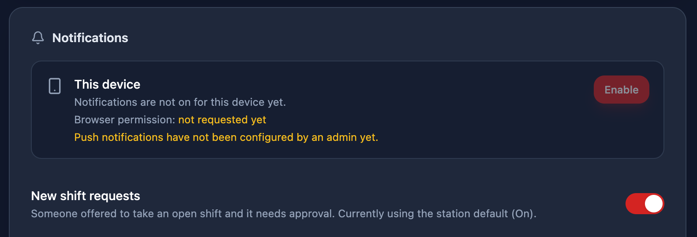

*Scheduling → Pending Approvals* is the queue of members asking to fill open shifts. It is the counterpart of the member's offer flow: they ask, you decide.

> [!IMPORTANT]
> Approving shift requests/offers requires the **Approve shift requests** role permission.

## What appears here

Every offer that has been made and not yet decided on, oldest first, so the **longest-waiting request is at the top**. Each row shows the member, the shift they want (date, time window and assignment), their assignment and the hours involved.

> [!NOTE]
> **Only undecided offers are listed.** An offer you have approved or declined leaves the queue, and the badge in the header counts what is still waiting. If the queue looks empty, there is nothing outstanding — it is not a loading problem.

## Deciding on an offer

- **Approve** writes the member onto that shift. The schedule board and the member's own calendar both update to show them on it.
- **Decline** closes the offer without touching the schedule, leaving the shift open.

Either way **the member is notified** on any device they have registered for notifications, and their calendar stops showing the amber pending pill.

> [!TIP]
> Approving also closes any other offers waiting on the same slot, so nobody is left told they are still in the running for a shift that has just been filled.

## Sorting and filtering the queue

Above the table are three controls:

| Control | What it does |
|---|---|
| **Member** | Show only one member's offers. |
| **Assignment** | Show only offers for one assignment. |
| **Sort** | How the queue is ordered. |

The member and assignment lists are built from **the offers actually waiting**, not from the whole roster — a filter listing everyone in the department, most of whom have nothing pending, would be mostly dead ends. **Clear filters** appears once either is set, and a count shows what is being shown, such as *3 of 11 offers*.

### The shift must still be open

Offers are matched to a shift that was unfilled when the offer was made. If somebody else was assigned to it in the meantime, approving cannot fill it — check the schedule instead, and decline the offer with a message to the member if it was lost that way. A member cannot offer on a shift that is already filled, and the same member cannot hold two pending offers on one shift.

## Being told about new offers

Check **New shift requests** in *User Profile → My Settings → Notifications* to be pushed a notification each time a member offers. 

## If a decision looks like it did not take

The action refreshes the queue, the schedule and the offers list in one go, which takes a few seconds. Confirm on **Schedule Management** that the shift now shows the member before assuming the approval failed, and reopen this tab if the row is still listed — a rejected decision shows a message explaining why.
