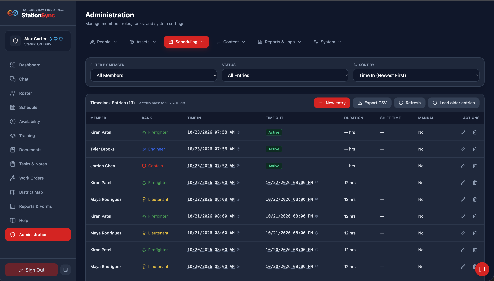
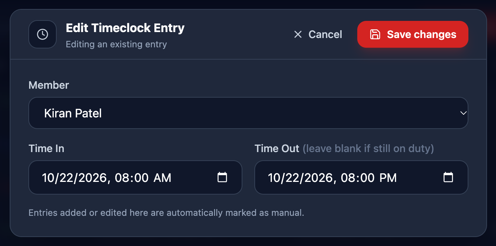

*Scheduling → Clock Management* is the department's clock record: every entry, who it belongs to, and the corrections. It is where you fix what members cannot fix themselves.

> [!IMPORTANT]
> Managing the timeclock requires the **Manage the timeclock** role permission.

## What the table shows

| Column | Notes |
|---|---|
| **Member** | Who the entry belongs to |
| **Time In** / **Time Out** | When they clocked in and out. A blank time out means the entry is still open |
| **Duration** | The length of a completed entry |
| **Shift Time** | Relevant for only some departments, ask your StationSync rep if you want more information |
| **Location** | Where it was recorded, if the device provided it, by hovering over the time |
| **Manual** | **Yes** for any entry an administrator created or changed |

Times follow your own **Time Format** preference, so they match the rest of the app for you.

## Fixing an entry

- **New entry** (top right of the entries card) creates one from scratch — for someone who could not clock in, or for a shift worked before the system existed. The editor opens over the page, with Save and Cancel in a bar at the top of it.
- **Edit Entry** corrects an existing one, including setting a time out on an entry that was left open.

> [!CAUTION]
> **Anything you create or change is flagged as manual.** That flag is deliberate and permanent for that entry: it makes a correction visible to anyone reviewing the record, so the hours and the story behind them stay reconcilable.

## Exporting

**Export CSV** downloads the table as filtered, so narrow it first and then export if you need a pay-period extract rather than everything.

## Open entries

An entry with no time out keeps the member on the *Currently on duty* card. Those are usually a forgotten clock-out, and closing one is a normal correction: set the time out to when they actually finished, and the entry becomes manual so the change is recorded.

If an open entry is from a member who has left, closing it is still the right move — an indefinite open entry will otherwise sit on the on-duty list forever.
