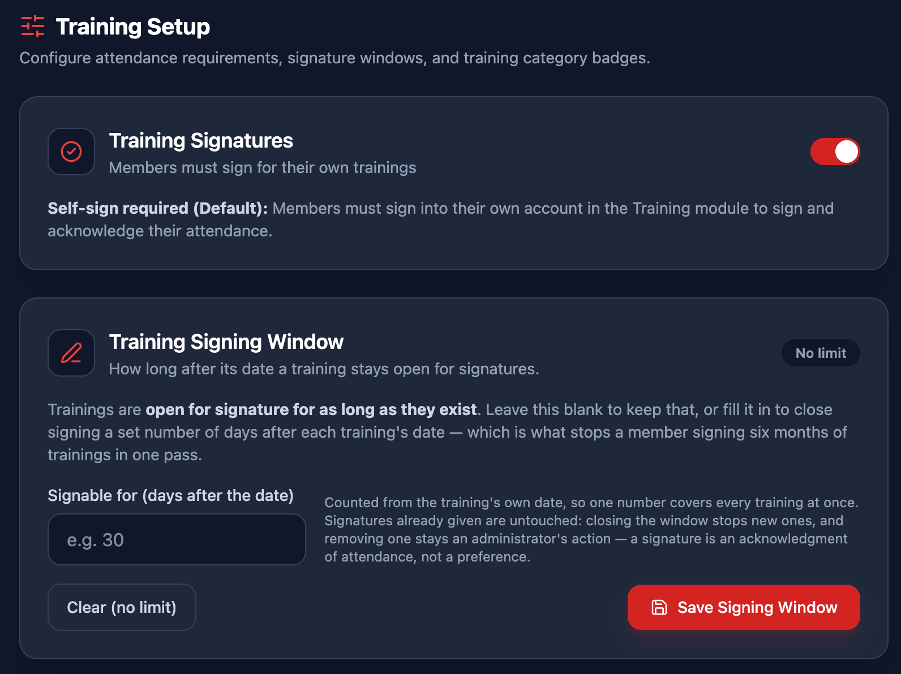
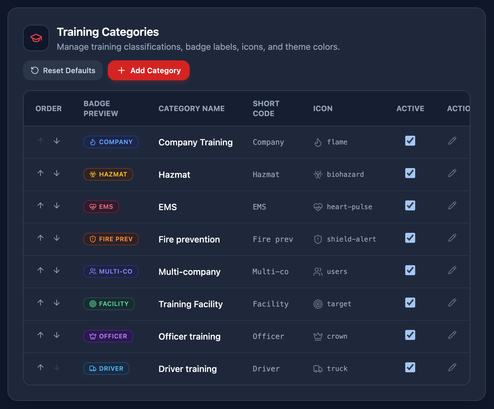

# Training Setup

*Content → Training Setup* is where department officers configure training attendance requirements, signature deadlines, and training category classifications.

IMAGE HERE

## Attendance & Signing Rules

The **Attendance & Signing Rules** card controls whether members are required to electronically sign their attendance:

- **Members Must Sign Attendance** — When enabled, members must individually log in to the Training module and sign for trainings they attended. When disabled, training officers or instructors can record attendance directly, and sessions do not remain in an unsigned state waiting for members.
- **Signing Window** — The number of days after a training date during which members can sign. Once this window closes, the training is locked for member signatures, preventing late or backdated attendance claims. Setting this to *Unlimited* allows members to sign at any time.

## Training Categories

The **Training Categories** card defines the classifications used across the department's training records (such as *Company Training*, *EMS*, *Hazmat*, *Driver/Operator*, and *Live Fire*):

- **Category Name & Description** — The title displayed on training cards, filters, and state reporting summaries.
- **Color Theme & Icon** — Choose a distinct badge color and icon so members and officers can quickly distinguish training types on calendars and reports.
- **Display Order** — Use the up and down arrows to reorder categories so the most frequent training types appear first in dropdowns.
- **Adding & Removing Categories** — Click **Add Category** to create a new classification. Categories with historical records can be hidden or retired without deleting historical attendance.

