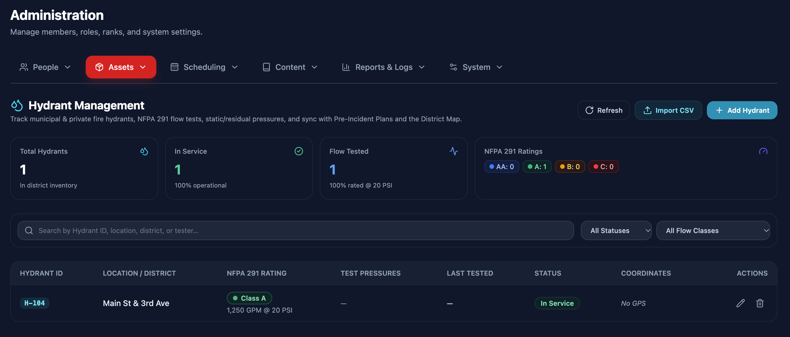
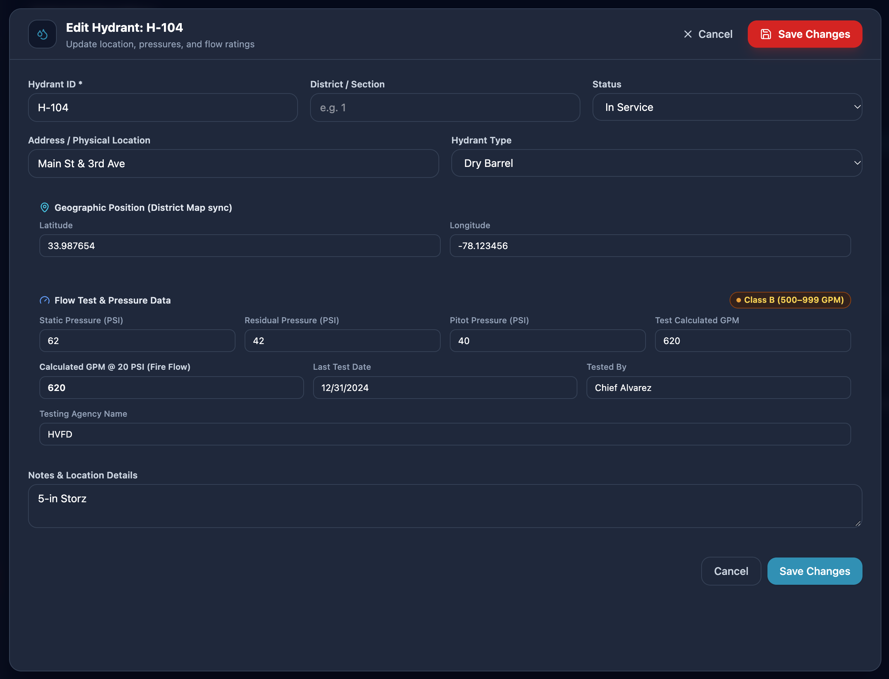
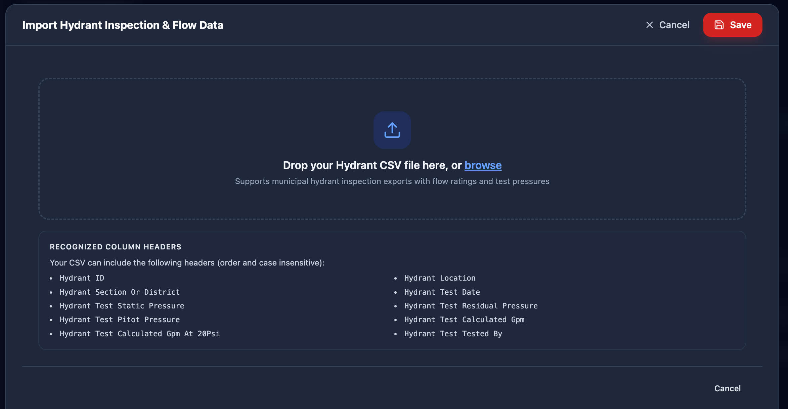
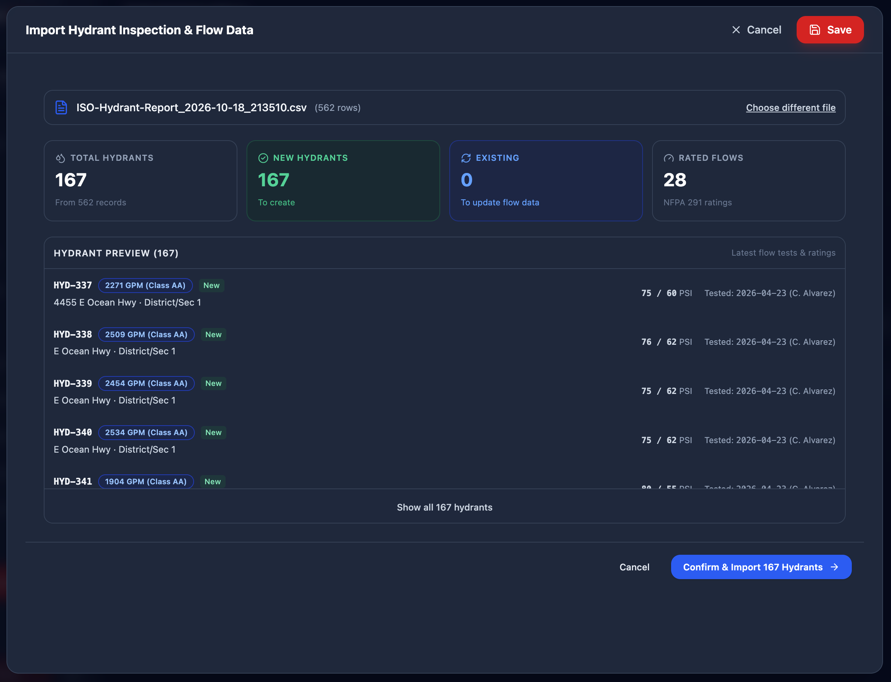

# Hydrants

*Assets → Hydrants* (also accessible from District Map settings) manages the department's database of municipal pressurized hydrants, dry hydrants, and water draft sites.

## Managing Hydrant Records

The table lists every hydrant in the department's response area with its operational status, location, and flow capacity:

- **Hydrant Identifier** — The official municipal or department number (such as *HYD-104*).
- **Location & Coordinates** — Street address and precise GPS coordinates (latitude and longitude). Entering GPS coordinates automatically maps the hydrant on the **District Map**.
- **Status** — Mark hydrants as *In Service*, *Out of Service*, or *Needs Maintenance*. Out-of-service hydrants are prominently highlighted on maps to alert responders during incidents.
- **Hydrant Type** — Choose between standard municipal pressurized hydrants, dry hydrants (suction-only ponds/cisterns), and natural draft sites.

## Flow Testing & NFPA Classifications

Entering flow test pressures automatically calculates discharge rates and color classifications according to **NFPA 291**:

| NFPA Class | Capacity (at 20 PSI) | Standard Bonnet / Marker Color |
|---|---|---|
| **Class AA** | 1,500 GPM or greater | Light Blue |
| **Class A** | 1,000 to 1,499 GPM | Green |
| **Class B** | 500 to 999 GPM | Orange |
| **Class C** | Less than 500 GPM | Red |

- Record the **Static Pressure**, **Residual Pressure**, and **Pitot Pressure** from your flow tests. The system calculates available flow at 20 PSI residual pressure.
- Track **Last Tested Date** and **Tested By** to maintain department ISO and insurance audit records.

## Bulk CSV Import

To load a large inventory from your county GIS or water utility:

1. Click **Import Hydrants** above the table.
2. Select your CSV spreadsheet file.
3. Match the column headers from your spreadsheet to the corresponding fields (Identifier, Address, Latitude, Longitude, GPM).
4. Review the preview and click **Import** to add or update records.

