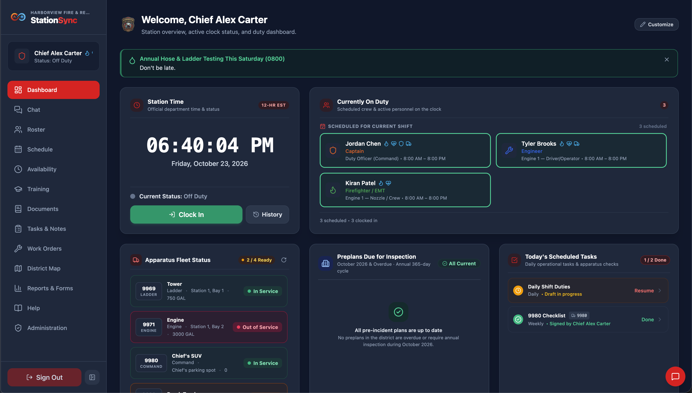

## Welcome

Welcome to **StationSync**. This guide is for members: what each module is for, and when to use it. Every entry in the list on the left covers one module — start here, then jump to whichever one you need.

## The modules

| Module | What it is for |
|----|----|
| **Dashboard & Timeclock** | Station command center, clock in and out, duty status, and current crew on duty |
| **Clock History** | Every shift entry you have logged, with filterable running totals |
| **Chat** | Real-time station rooms, shift messaging, and private 1-on-1 conversations |
| **Roster** | Department personnel directory, member ranks, and active qualifications |
| **Schedule** | Your assigned shifts, department calendar, and open shifts you can offer to fill |
| **Availability** | Tell the department which recurring shift windows you can work |
| **Training** | Review completed department training sessions and electronically sign your attendance |
| **Certifications** | View your active credentials, licenses, expiration dates, and attached certificate files |
| **Documents** | Department policies, standard operating guidelines, and interactive checklists |
| **Tasks & Notes** | Operational station chores, apparatus checklist inspections, and shift pass-down notes |
| **Work Orders** | Report and track apparatus, equipment, and station repair requests |
| **District Map** | Interactive map with official fire district boundaries, water sources, and station landmarks |
| **Reports & Forms** | Generate pre-filled official department PDF forms |
| **Help** | These guides and feature references |

> [!NOTE]
> **Administration** also appears in your sidebar if your assigned role includes officer or administrative permissions. Information about administrative setup can be found under *Administration → System → Help*.

IMAGE HERE

## Signing in

Your username and password are provided by a department administrator. If you forget your password, ask an administrator to reset it. You can change your password anytime by clicking your name at the top of the sidebar to open your **User Profile**.

When you first use the app, you may be asked to re-enter your password before an important action (such as clocking in). The app is simply confirming your identity. Once confirmed, your action completes automatically.

> [!CAUTION]
> If you are using a shared station computer or apparatus tablet, always click **Log out** at the bottom of the sidebar when you finish your shift. Simply closing the browser tab will leave you signed in.

IMAGE HERE

## Why a module might be missing

The modules you see in the sidebar depend on your assigned **role**. If you do not see a module you need, your role may not have access to it yet. An administrator can update your role permissions.

To check your current permissions, click your name at the top of the sidebar to open your **User Profile**, switch to the **My Settings** tab, and view the **Your Access** card. This lists every permission your account currently has.

## A couple of extras

* The **Firefighter Runner** is a fun mini-game hidden inside the app! Look around and tap the right spot to find it.

## Release notes & changelog

Full release notes and version history for **StationSync** are published on [stationsync.net/#changelog](https://stationsync.net/#changelog).
