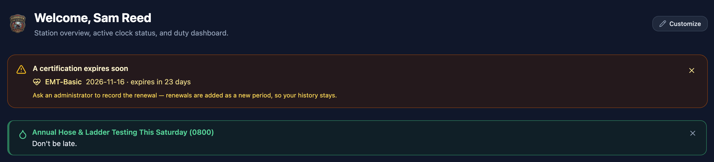

# My Certifications

Your certifications (like EMT, CPR, EVOC, or Driver/Operator) are tracked in your **User Profile**.

IMAGE HERE

To see your certifications, click your name at the top of the sidebar to open your **User Profile**, and click on the **Certifications** card under the **My Profile** tab to expand it.

## Viewing your certifications

The Certifications card is a quick reference for all credentials the station has on file for you. It shows what you hold, when each credential started, and when it is set to expire.

IMAGE HERE

Because certifications are official department records, they are entered and verified by department administrators. If a certification is missing or has incorrect dates, let an administrator know so they can update your record.

## Viewing attached files

When an officer attaches a copy of your certificate card or document (such as a PDF or photo), you will see a **View upload** button next to that certification. Click the button to view or download a copy of the certificate.

## What the statuses mean

| Status | Meaning |
|---|---|
| **Current** | Your certification is active and up to date |
| **Expires soon** | Your certification is coming up on its expiration date and needs to be renewed soon |
| **Not yet effective** | The start date for this certification is in the future |
| **Expired** | The end date has passed — please contact an administrator to renew it |

## Expiration warnings at sign-in

When an important certification is close to expiring, the app will give you a helpful reminder right at the top of the Dashboard when you sign in. This ensures you never miss a renewal deadline.

## Renewals

When you renew a certification, an administrator adds a new date range rather than erasing your previous one. This means your training history is always preserved for station and state audits.